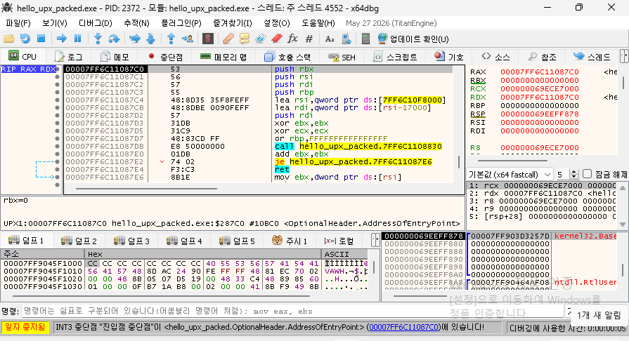
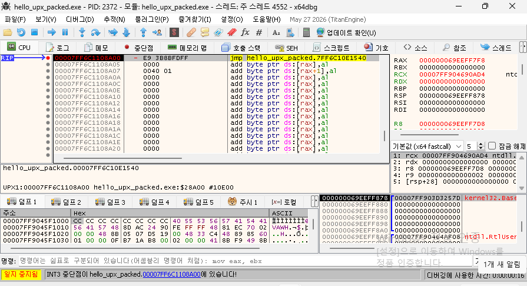
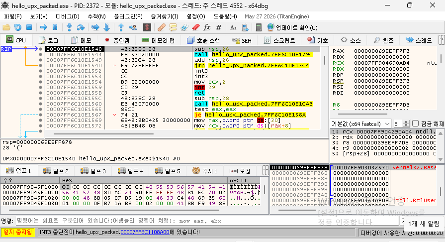

A benign x64 program was packed with UPX and unpacked two ways inside a network-isolated VM: a small Python debugger that finds the tail jump statically, breaks on it, and reads the original entry point (OEP), and the same step followed by hand in x64dbg. The recovered OEP, the program's output, its 79 imports and its `.text` bytes all match the original, and a YARA rule for the UPX layout flags the packed file while matching none of 18,838 files in System32.

<!--more-->

## 1. English Summary [AI]

UPX is the most common off-the-shelf PE packer, and unpacking its default stub is the first thing a malware analyst learns. This post reproduces that end to end on a program written for the purpose, so nothing here touches a real sample. The target prints fixed text, upper-cases a string, hashes a string with the CryptoAPI and reports the processor architecture — no user, host, path, time or network input. It is built reproducibly with MSVC, packed with `upx --best`, then unpacked twice: once by [`tools/unpack_upx.py`](tools/unpack_upx.py), a Python debugger that walks the stub to the OEP and rebuilds the import table, and once by hand in x64dbg. [`tools/verify.py`](tools/verify.py) checks the two unpacked results against the original on four axes. Every number below is copied from the run logs in [`results/`](results/verify.json); the executables themselves never enter the repository, only their SHA-256.

## 2. 목적 [AI]

이 글의 목적은 UPX 기본 스텁을 **원리까지 열어 보이는 것**이다. "UPX로 패킹됐다"는 한 줄은 쉽지만, 실제로 분석할 때 필요한 것은 ① 압축이 풀리는 순간(테일 점프)을 어떻게 찾는가, ② 그 순간의 원래 진입점(OEP)이 정적으로 읽은 값과 같은가, ③ 임포트 주소 테이블(IAT)을 어떻게 되살리는가다. 이 셋을 자동(Python 디버거)과 직접(x64dbg) 두 길로 각각 보이고, 결과가 같은지 검증한다.

대상은 **직접 만든 무해 프로그램**이다. 실제 악성코드로 시작하지 않는 이유는 분명하다 — 방법을 먼저 통제된 입력으로 확인해야, 나중에 진짜 샘플에서 나온 값을 믿을 수 있다. 모든 실행은 업링크 없는 격리 VM에서, 매 실행 전 클린 스냅샷으로 되돌린 상태로 한다.

## 3. 대상 프로그램 [AI]

소스는 [`src/hello_upx.c`](src/hello_upx.c), 빌드 스크립트는 [`src/build.cmd`](src/build.cmd)에 있다. 하는 일은 네 가지뿐이다:

1. 고정 문구 `uplinkless UPX demo`를 출력한다.
2. `user32!CharUpperA`로 그 문자열을 대문자로 바꿔 출력한다.
3. `advapi32` CryptoAPI(`CryptAcquireContextW` → `CryptCreateHash` → `CryptHashData` → `CryptGetHashParam`)로 그 문자열의 SHA-256을 구해 16진수로 출력한다.
4. `kernel32!GetSystemInfo`로 프로세서 아키텍처 값만 출력한다(x64면 9).

사용자명·호스트명·경로·PID·시각·네트워크는 읽지 않는다. 출력은 입력에 의존하지 않으므로 어느 환경에서 돌려도 같다 — 덤프본이 원본과 같은지 바이트로 비교할 대조군이 된다.

빌드는 MSVC 14.50(Visual Studio 18 Community) x64, `cl /O2 /MT /GS /Brepro ... /link /Brepro /DYNAMICBASE user32.lib advapi32.lib`로 한다. `/Brepro`는 같은 소스·같은 컴파일러면 출력 바이트가 같게 만든다(타임스탬프 등 비결정 요소 제거). 패킹은 `upx --best`(UPX 5.3.0).

세 파일의 SHA-256(실행 파일은 저장소에 넣지 않는다):

| 파일 | SHA-256 |
|---|---|
| `hello_upx.exe` (원본) | `5bf252c8ba34ea4e7df264c4411c31cd601b9dcba2d8544a0e199c52b4554f5d` |
| `hello_upx_packed.exe` (패킹본) | `d926714f0ead8873b0b1f0bda72cc83c13885a72cca313bdeb2ead919bdd0685` |
| `hello_upx_dumped.exe` (덤프본) | `b840a644a6c4b0b47f76f97c7768fd8a38e341b901990a1cf4c8338baec0182c` |

## 4. 원리 [AI]

UPX는 PE를 두 섹션으로 다시 짠다. **`UPX0`**은 파일에는 크기 0으로 들어 있고 메모리에서만 커지는 빈 섹션 — 압축이 풀린 원본 코드가 들어갈 자리다. **`UPX1`**은 압축된 원본 데이터와 그것을 푸는 스텁(언패킹 코드)을 담는다. 진입점은 `UPX1` 안의 스텁을 가리킨다.

실행하면 스텁이 순서대로 ① `UPX1`의 압축 데이터를 `UPX0`으로 풀고 ② 임포트를 해석해 IAT를 채우고 ③ (필요하면) 재배치를 적용한 뒤 ④ **테일 점프** — `UPX0` 안의 원래 진입점(OEP)으로 뛰는 단 하나의 `jmp`로 제어를 넘긴다. 그 `jmp`를 실행하기 직전이 "메모리에는 원본이 다 풀렸고, 아직 원본 코드는 시작 전"인 순간이다. 덤프를 뜨기 정확히 좋은 지점이다.

x86 UPX 스텁은 레지스터를 `PUSHAD`로 저장하고 복원 때 `POPAD`를 하므로, 저장된 스택 자리에 하드웨어 중단점을 걸어 테일 점프를 잡는 고전 기법이 통한다. x64에는 `PUSHAD`/`POPAD`가 없다. 대신 x64 스텁은 스택을 `sub rsp,-0x80`(바이트 `48 83 EC 80`)으로 정리한 직후 테일 점프를 두는 형태가 많다 — 이 글의 자동 언패커는 그 바이트 패턴을 테일 점프 식별의 보조 신호로 쓴다.

## 5. 재현 절차

### 5.1 자동 언패커 [자동]

[`tools/unpack_upx.py`](tools/unpack_upx.py)는 정답을 미리 넣지 않고 패킹본만 보고 OEP를 찾는다. 순서는 원리 그대로다:

1. **테일 점프를 정적으로 찾는다.** pefile로 `UPX0`과 진입점(EP)을 얻고, EP부터 `UPX1`을 훑어 목적지가 `UPX0` 범위 안인 첫 `E9 rel32`(jmp)를 테일 점프로 정한다. 바로 앞 4바이트가 `48 83 EC 80`이면 함께 기록한다.
2. **동적으로 OEP를 확정한다.** `CreateProcessW(DEBUG_ONLY_THIS_PROCESS)`로 실행하고 테일 점프 자리에 `int3`를 심는다. 걸리면 원래 바이트를 되돌리고 트랩 플래그로 한 단계 실행한다 — 그때 RIP가 OEP다.
3. **이미지를 덤프한다.** OEP 시점에 `ReadProcessMemory`로 이미지 전체를 읽는다.
4. **IAT를 복구한다.** 덤프 안에서, 로드된 DLL들의 export 주소를 가리키는 8바이트 포인터가 연속된 가장 긴 구간을 IAT로 보고, 각 포인터를 DLL·함수 이름으로 되돌린다(로드된 모듈 목록 + 디스크의 export 표, forwarder까지 따라감). 새 섹션 `.idata2`에 임포트 디렉터리를 만들되 IAT 자체는 원래 자리를 그대로 쓴다.
5. **PE를 다시 쓴다.** 섹션 원시 크기를 가상 크기에 맞추고, 진입점을 OEP로, ImageBase를 실제 로드 주소로 바꾸고, `DYNAMICBASE`와 재배치 디렉터리를 제거한다. 결과가 `hello_upx_dumped.exe`다.

순수 함수(테일 점프 탐색, IAT 구간 찾기, 임포트 섹션 생성, PE 재작성)는 OS와 무관하게 단위 시험으로 검증한다 — [`tools/test_unpack_upx.py`](tools/test_unpack_upx.py). 격리 VM에서 돌린 로그는 [`results/unpack_log.json`](results/unpack_log.json)이며, 핵심 값은:

- 진입점 EP RVA `0x287c0`
- 테일 점프 RVA `0x28a00`, 앞선 `sub rsp,-0x80` 패턴 있음(`true`)
- 테일 점프의 정적 목적지 RVA `0x1540`
- 동적으로 확정한 OEP RVA `0x1540` — **정적 목적지와 같다**
- 복구한 임포트: `advapi32.dll` 6개, `kernel32.dll` 72개, `user32.dll` 1개

정적으로 읽은 테일 점프 목적지(`0x1540`)와 디버거로 한 단계 밟아 확정한 OEP(`0x1540`)가 일치한다 — 스텁이 다른 데를 거치지 않고 OEP로 바로 뛴다는 뜻이다.

### 5.2 x64dbg로 손으로 [직접]

같은 과정을 사람이 x64dbg로 밟아 자동 결과를 교차 확인한다. 격리 VM에서 패킹본을 열고 진입점까지 실행하면, 진입점은 `UPX1` 섹션 안의 스텁이다. 상태바가 `AddressOfEntryPoint`임을 확인해 준다:

테일 점프(`cip + 0x240`, 즉 EP RVA `0x287c0` + `0x240` = `0x28a00`)로 이동해 중단점을 걸고 실행하면, 스텁이 압축을 다 푼 뒤 그 `jmp`에서 멈춘다. 명령은 `jmp <base>+0x1540` — 목적지가 OEP다:

한 단계 실행하면 `jmp`를 따라 `0x1540`에 도착한다. 상태바가 `UPX0:...$1540`을 가리킨다 — 이제 `UPX0`에 풀린 원본 코드의 시작(OEP)이다:

손으로 찾은 OEP(`0x1540`)는 자동 언패커가 낸 값과 같다.

## 6. 검증 [자동]

[`tools/verify.py`](tools/verify.py)가 덤프본과 `upx -d` 사본을 원본과 대조한다. 전체 결과는 [`results/verify.json`](results/verify.json)이며 네 항목 모두 통과했다:

| 항목 | 방법 | 결과 |
|---|---|---|
| OEP | 로그의 OEP RVA vs 원본 `AddressOfEntryPoint` | `0x1540` = `0x1540` 통과 |
| 동작 | 덤프본·패킹본 출력 vs 원본 출력(바이트) | 132바이트, 패킹본·덤프본 모두 원본과 동일 통과 |
| 임포트 | 덤프본 임포트 집합 vs 원본 | 79개 = 79개, 누락 0·추가 0 통과 |
| 코드 | 원본 `.text` vs 덤프본 같은 RVA 구간(재배치 보정) | `0x148a0`바이트, 재배치 0곳, 다른 바이트 0 통과 |

세 실행(원본·패킹본·덤프본)의 출력 SHA-256은 모두 `7715f7c18acbe0566ba4cd96e25ed58c65585af56a7669dbeacbdc639a438edf`로 같다. 보조 대조로 `upx -d`의 섹션 해시는 우리 덤프본과 **같지 않다**(`upx_d_sections_equal: false`) — 둘 다 올바른 원본 동작을 복원하지만 레이아웃이 다를 수 있다는 점을 보인다. 이는 합격 기준이 아니라 참고 값이다.

## 7. 탐지 관점 [자동]

파일 층 YARA 룰 [`rules/upx_packed_pe.yar`](rules/upx_packed_pe.yar)은 UPX 기본 레이아웃을 본다: MZ/PE 헤더, 섹션 이름 `UPX0`·`UPX1`, 그리고 앞쪽 `UPX!` 표식. 격리 VM에서 돌린 결과는 [`results/yara_check.txt`](results/yara_check.txt):

| 층 | 형식 | 결과 | 검증 |
|---|---|---|---|
| 파일 | YARA `upx_packed_pe` | 패킹본 일치, 덤프본 일치 | 격리 VM에서 룰 실행 |
| 파일(오탐) | 동 룰을 `System32`에 재귀 | 18,838개 중 0개 일치 | 격리 VM `yara64.exe -r` |
| 엔드포인트 | — | 해당 없음 | 패킹 자체는 행위가 없다 |
| 네트워크 | — | 해당 없음 | 패킹 자체는 통신이 없다 |

**덤프본이 룰에 걸리는 것은 의도된 결과다.** 언패커는 섹션 이름(`UPX0`/`UPX1`)과 헤더를 원본 메모리 레이아웃 그대로 옮기므로, 코드는 풀렸어도 UPX의 구조 표식은 남는다. 즉 이 룰은 "실행 시 압축이 풀리는가"가 아니라 "UPX 구조로 짜였는가"를 보며, 언패킹했다고 그 구조가 사라지지는 않는다.

엔드포인트·네트워크 층은 이 글의 대상(패킹이라는 정적 변형)에 해당하지 않는다. 행위·통신 관측(Sysmon, FakeNet-NG)은 다음 단계(P1)에서 들인다.

## 8. 한계 [AI]

1. **가장 단순한 패커다.** 이 언패커는 UPX **기본 스텁**만 다룬다. 섹션 이름을 바꾸거나 `UPX!` 표식을 지운 변종은 7절 룰도, 2단계의 정적 섹션 판정도 피한다 — 그런 경우엔 엔트로피나 스텁 바이트 패턴 같은 다른 신호가 필요하다.
2. **헤더 변조에 약하다.** `upx -d`는 UPX가 남긴 헤더 정보에 의존하므로, 그 헤더가 변조되면 거부한다. 이 글의 덤프 방식(메모리에서 직접 뜨기)은 그 경우에도 되지만, IAT 복구 가정이 깨지면 실패한다.
3. **IAT가 연속 구간이라고 가정한다.** 임포트 복구는 export 포인터가 메모리에서 연속된 가장 긴 구간을 IAT로 본다. 임포트를 흩뿌리거나 동적으로 해석하는(예: 실행 중 `GetProcAddress`로 채우는) 코드에는 이 가정이 통하지 않는다.
4. **탐지 우회·로더 기능은 없다.** 학습용 언패커이며, 안티분석 회피나 페이로드 실행 기능을 넣지 않았다. 격리 VM에서, 실행이 허용된 파일에만 돌려야 한다.

## 9. AI 사용 내역 [AI]

| 구간 | 한 주체 | 내용 |
|---|---|---|
| 대상 프로그램·도구 작성 | Claude (Anthropic) | `hello_upx.c`, `unpack_upx.py`, `verify.py`, 단위 시험, YARA 룰, 이 글 초안 |
| 자동 언패킹·검증 실행 | 스크립트(격리 VM) | 테일 점프 탐색 → OEP 확정 → 덤프 → IAT 복구 → 4항목 검증, 로그는 `results/` |
| 직접 구간 | 사용자 | x64dbg로 EP→테일 점프→OEP를 손으로 밟고 자동 결과 교차 확인 |
| 검토·승인 | 사용자 | 모든 절과 수치를 검토하고 공개를 승인 |

이 글의 모든 수치는 격리 VM 실행 로그([`results/`](results/verify.json))에서 옮겼으며, 손으로 만든 값은 없다.
